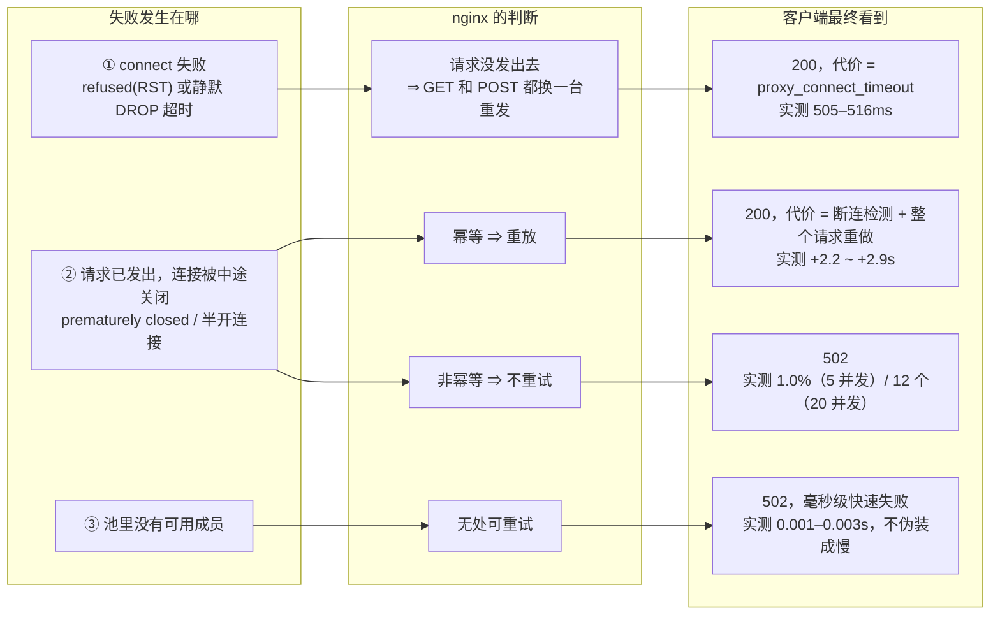

# 摘流方案与实验台账

> 本页是 [`README.md`](README.md)、[`REPORT.md`](REPORT.md)、[`REPORT-l4-probe.md`](REPORT-l4-probe.md)
> 三份文档（1879 行）的汇总：只保留实测过的结论，并标出哪些结论后来被推翻。
> 环境：kind 5 节点 · ingress-nginx chart 4.15.1 / controller 1.15.1 · 集群外 nginx 1.27 做 LB。
> 实验日期 2026-10-14 → 10-16，最大单轮 31408 请求。

---

## 01 一句话结论

> **决定「关掉一个 infra 节点会不会掉请求」的，按重要性排序是：节点是怎么关的 → 请求有没有发出去 → 摘流有多快 → 最后才轮到 L4 还是 L7 探测。**
>
> L4 与 L7 探测在「节点真 down」这一类故障上完全等价（同时刻失败、同耗时摘流、同样不掉）。
> 差别只在盲区：三次握手成功但数据面不工作时，L4 判健康，非幂等请求直接 502。

| 场景 | 结果 | 代价 | 样本 |
|---|---|---|---|
| 计划内维护，走推荐流程（§04） | **0 个非 200 / 0 客户端断连 / 0 次 reload** | 无，p99 与基线一致 | 5600 |
| 非计划硬 crash，只靠 LB 探测 | ~10 个 502 | 8s 内摘除，长尾限制在几秒 | ~5600 |
| 什么都不做，直接 `docker restart` | **12 个 502** | 在飞 19 个里约一半被切 | 3447 |
| 只有 nginx 被动健康检查（`max_fails`） | 0 个 5xx，但 **7.1% 三秒长尾** | p95 3006ms，贯穿整个故障期 | 450 |

「不报错但很慢」是最危险的一种故障形态：状态码全 200，从错误率上完全看不出来。
**观测要盯 p99 和 upstream 重试次数，不是只看状态码。**

---

## 02 失败是怎么产生的

整份实验只有一条因果链。所有 502、所有长尾，都能归到「失败发生在哪个阶段」上。



同一张图解释了三个看起来矛盾的结果：为什么 connect 超时只是慢、为什么硬 crash 会真掉、
为什么 drain 一个都不掉（drain 让节点先摘 endpoint，压根不进入 ①②③ 任何一条）。

**由此得到的三条推论**

- 把 `proxy_connect_timeout` 从 3s 降到 500ms，是把「① 慢」的代价上限按比例缩小：p95 从 3006ms 变成 19ms。
- **爆炸半径 ≈ 在飞请求数 × 1/N(infra 节点数)**。5 并发 / 2 节点 → 2 个；20 并发 → 10 个。
  想「硬 crash 也不掉」，只能靠幂等键 + 客户端重试，或者把下线变成 drain。
- 非幂等请求的 502 不能靠 LB 参数消除，只能靠「不让在飞请求被切」——先摘流、等排空、再关。

---

## 03 方案：三层职责

整套配置只服务一个不变量：

> **上游 LB（实验里的 nginx-external，生产里的 BGP/ECMP）接流量的每一个节点，本节点必须至少有一个 Ready 的 ingress pod。**
>
> 因为 `externalTrafficPolicy: Local` 下，节点没有本地 endpoint 时 kube-proxy 对该节点的 NodePort 是**静默 DROP，不是 RST**。

| 层 | 保证什么 | 手段 |
|---|---|---|
| **k8s** | 每个节点都有 endpoint | `nodeAffinity` 硬约束 + taint（在哪）；`replicas = 3×N` + `topologySpread maxSkew=1 / DoNotSchedule`（每个都有且均匀）；`PDB minAvailable: 50%`（维护时不归零）。宁可 pod Pending，也不要 6/0 分布——那样一半流量进黑洞 |
| **LB** | 没 endpoint 的节点不接流量 | L7 探 `:31000/healthz`（**不带业务 Host 头**，否则被 ingress 规则抢走）；`interval 2s / fail 2 / ok 2`；`connect 500ms`、`read 10s`、`tries 2`；成员文件原子替换、永不为空 |
| **节点** | 计划内维护自己摘流 | `iptables -t nat -I PREROUTING 1 --dport 31000 -j DNAT --to <nodeIP>:1`，让内核自己回 RST。LB 探测从「等 connect 超时」变成「立刻失败」，摘流从 22s 降到 4s，不动 LB 一行配置 |

职责一句话：**k8s 保证「每个节点都有 endpoint」，LB 保证「没 endpoint 的节点不接流量」，节点侧保证「计划内维护时 LB 根本不需要动」。**

### 让节点侧摘流真正生效的那两行

实测反直觉的一条：**静态池下节点侧摘流完全不起作用** —— LB 一直复用已有的上游 keepalive 连接，
插了摘流规则后 conntrack 计数 70s 都不降。加上这两行后 12s 归零。已写进 `nginx/conf/nginx.conf.tmpl`。

```nginx
upstream k8s_ingress_nodeport {
  least_conn;
  include /etc/nginx/upstream/nodeports.conf;  # 原子替换，永不为空
  keepalive          64;
  keepalive_time     10s;   # ← 关键：不限制寿命，节点侧摘流就是空操作
  keepalive_requests 20;
}
proxy_connect_timeout       500ms;
proxy_read_timeout          10s;      # 默认 30s 会让半开连接卡满 30s
proxy_next_upstream         error timeout http_502 http_503 http_504;
proxy_next_upstream_tries   2;
proxy_next_upstream_timeout 5s;       # 必须 > 业务最长正常响应时间，否则反而制造 502
```

外加一个外挂探测循环，支持三个名单：`manual_down.list`（人工下线）、`manual_hold.list`（维护中不摘）、
可用节点为 0 时拒绝应用。**单一写入者原则**：维护脚本只写名单，落盘和 reload 由健康检查做 —— 否则每次维护多两次 reload。

---

## 04 最终推荐流程

思路：计划内维护在节点侧摘流，不碰 LB、不 reload；主动摘流只留给非计划故障，并在维护期间用 hold 名单抑制它。
唯一要记的命令：

```bash
./scripts/graceful-reboot-infra.sh <node> [wait-conn-seconds]

[1/8] cordon
[2/8] 写 manual_hold（告诉 LB 别摘，省两次 reload）+ 节点侧 nat 摘流(RST)
[3/8] 等 conntrack 连接数 = 0            # 用 conntrack，不能用 ss：NodePort 是 DNAT，没有本地 socket
[4/8] drain --grace-period=60            # endpoint 先摘，在飞请求跑完
[5/8] reboot                             # 不要在 reboot 前删 nat 规则：会留下 kube-proxy DROP 黑洞
[6/8] 等节点 Ready
[7/8] 先 uncordon                        # cordon 状态下 pod 永远 Pending
[8/8] 等 /healthz 连续 2 次通过 → 解除 hold   # 加回要慢
```

### 方案横评（都是 CONC=20、POST、后端 1s、约 5600 请求，同一集群同一拓扑）

| 方案 | 计划内 502 | 客户端断连 | reload | 非计划 crash |
|---|---:|---:|---:|---|
| A 直接 `docker restart` | **12** | 3 | 2 | — |
| B cordon → drain → restart | 0 | 3 | 2 | — |
| C cordon → LB 预摘流 → drain → restart | 0 | **8** | 2 | — |
| D cordon → 节点侧摘流 → 等排空 → drain → reboot | 0 | 7 | 2 | ~10 个，4s 摘除 |
| E LB 标 down → 等排空 → 节点侧兜底 → … | 0 | 6 | 3 | — |
| F 静态池（无主动摘流）+ `keepalive_time` + 节点侧摘流 | 0 | 0 | 0 | 8 个 + **96 次 500ms 长尾，贯穿故障期** |
| **G 推荐：F 的配置 + 保留主动摘流，维护期抑制** | **0** | **0** | **0** | ~10 个，8s 摘除，长尾短 |

F 在计划内维护上做到了极致，代价全在非计划故障 —— 这就是 G 保留主动摘流的原因。

> **什么时候仍然需要 LB 预摘流（C）**：不能 drain（必须硬关机）／摘流信号是静默 DROP 而不是 RST／
> LB 动态摘除成本高（BGP 撤销慢、reload 慢、探测间隔大）。三条都不沾时，预摘流是净成本：多两次 reload，客户端断连从 3 涨到 8。

---

## 05 测试台账

12 组实验，按「证明了什么」排列，不是按做的顺序。
开环 = 固定 rps、每请求新建连接；闭环 = N 个常驻 client、持久连接、始终有请求在飞。

| # | 场景 | 脚本 | 关键结果 | 判定 |
|---|---|---|---|---|
| T1 | 调度约束：2/3 infra 副本分布、只跑 infra、业务不污染 | `bootstrap.sh` `scale-infra.sh` | 3/3，扩到 3 infra 自动收敛 3/3/3；无 toleration 的 pod 调度失败 | 通过 |
| T2 | 流量语义：确认不跨节点 | `ingress-probe.py` | 打 infra-1 的 20 个请求全部由该节点 3 个 pod 处理，另一节点 0；ITP=Local 下非 infra 节点访问 ClusterIP 静默超时 | 通过 |
| T3 | 开环：只有被动 `max_fails` 时关掉一个节点 | `failover-test.sh` | 从不摘流；450 请求全 200，但 **7.1% 有 3s 长尾，p95 3006ms**，贯穿整个故障期 | 不可接受 |
| T4 | 开环：加 L7 主动探测，参数三档对比 | `failover-test.sh` | 5s/3+connect 3s → p95 39ms；2s/2+connect 500ms → **p95 19ms、长尾归零**、摘流 ~5s | 修复 T3 |
| T5 | 502/503 专项：切换瞬间会不会出 5xx | `switchover-check.sh` | 1602 请求 0 个 5xx；`no live upstreams` 0 次。两个 infra 全关时 → 502，0.001–0.003s 快速失败 | 通过 |
| T6 | L4 vs L7：真的关掉一个节点 | `failover-test.sh` `HC_MODE=l4` | **完全等价**：都是 +6s 摘流、0 个非 200；GET 和 POST 都靠重试兜住，代价 505–516ms | 等价 |
| T7 | L4 盲区：`:31000` DNAT 到 accept 即关的 TCP sink | `l4-blindspot-test.sh` | L4 判健康 → **POST 6% 真 502**、GET 17.3% 在重试；L7 → 6s 内摘除，0 掉 | L4 不够 |
| T8 | 闭环 5 并发 + 3s 慢请求，中途关节点（stop/kill/drain/restart） | `concurrency-failover-test.sh` | 硬 crash：POST 1.0% 502、GET 被重放 +2.2~2.9s；**drain：0 掉**；restart：3 个 502 | 取决于怎么关 |
| T9 | NodePort 与 ingress 的 GAP：每秒同时采样 tcp/healthz/biz/endpoint | `nodeport-vs-ingress-gap.sh` | 下线 GAP ≈5s（NodePort 已黑，API 还说有 endpoint）；上线 GAP ≈5s（已能服务，endpoint 还没出）；数据面黑窗 42s | 必须靠探测 |
| T10 | CONC=20 放大：去掉 LB 预摘流会怎样 | `concurrency-failover-test.sh` | **救回在飞请求的是 drain 不是 LB 摘流**；B 组（不碰 LB）502 仍为 0，因为 drain 让 NodePort 回 RST | 推翻预摘流 |
| T11 | CONC=100 复测推荐流程 | `maintenance-restart.sh` | 28017 请求：0 个 502、0 个 >2s、关节点在飞 88 个全部 200；12 个（0.043%）连接被断，全部「请求未到达后端」⇒ 重试安全 | 结论不依赖并发 |
| T12 | 2000 条持久连接（100 并发 × 20 连接）下的 reload 代价 | `concurrency-probe.py` | LB 动态 down/up（2 次 reload）→ **3808 个请求失败 = 12.1%**，100/100 个 client 各约 38 次；节点侧摘流（0 reload）→ 0 失败 | 推翻 T11 的断连数 |

### T12 的补充：客户端重试一次能不能抹平

| 配置（2000 连接，同一维护流程） | 失败请求 | 代价 |
|---|---:|---|
| LB 动态 down/up，不重试 | **3808 = 12.1%** | 连续 3 秒、每个 client 约 38 次 |
| 同上，客户端连接级失败重试一次 | **0** | +50ms（3825 次重试全部成功，因为 0 个到达过 LB） |
| 节点侧摘流，不 reload | **0** | 无 |

这就是「凭什么买商业 LB」的量化回答：开源能做对，但要求你同时掌握节点侧（自己摘流）和客户端（重试）两个前提。
商业 / 动态后端 LB（nginx Plus API、HAProxy runtime、Envoy xDS）卖的是**把这两个前提拿掉**。

### 代价模型（修正版）

```
一次 reload 杀掉的客户端连接数 ≈ 当时的空闲 keepalive 连接数
                              = 总连接数 × 空闲比例
                              = 总连接数 × (1 − 1/连接池大小)
```

每 client 1 条连接：空闲比例 ≈ think/(slow+think) ≈ 9% ⇒ 只打断几个。
每 client 20 条：任意时刻 19/20 空闲 ⇒ 几乎整个连接池被杀。真实（非同步）流量下就是后者。

---

## 06 被推翻的结论

这是三份文档最有价值、也最难读的部分：结论按时间顺序追加，前面的原文不删，推翻写在后面。集中列出来。

| 曾经的说法 | 修正后 | 证据 |
|---|---|---|
| 维护必须先做 LB 预摘流 | 救回在飞请求的是 k8s 侧的 drain。NodePort + ETP=Local 下 drain 让 NodePort 立刻回 RST，LB 探测 3s 内自己就摘了；预摘流只是多两次 reload | T10：B 组（完全不碰 LB）502=0、断连 3；C 组（预摘流）502=0、断连 8 |
| 每次 reload 固定打断约 3 个客户端连接 | ≈ 空闲 keepalive 连接数，与连接池大小成正比。低连接数下的「固定 3 个」是抽样错误 | T12：2000 连接下 3808 个失败（12.1%），100/100 个 client 命中 |
| 节点侧插摘流规则就够了 | 静态池下完全无效：LB 复用旧连接，conntrack 70s 不降。必须配 `keepalive_time` / `keepalive_requests` | 加两行后 12s 归零，1440 请求全 200、0 次 reload |
| `iptables -j REJECT` 放 filter INPUT 就能摘流 | 空操作。kube-proxy 的 DNAT 在更早的 nat PREROUTING，包到 INPUT 时 dport 已是 podIP:80。可用形式是 nat PREROUTING 抢在 kube-proxy 之前 DNAT 到没人监听的端口 | 插了规则后 `wget :31000/healthz` 仍 200；REJECT 放 mangle PREROUTING 被内核拒（Invalid argument） |
| L4 探测和 L7 等价，用哪个都行 | 只在「节点/端口不可达」上等价。「三次握手成功但数据面不工作」L4 全部误判健康，此时 GET 被重试掩盖、非幂等直接 502 | T6（等价）与 T7（盲区，POST 6% 真掉） |
| 并发越高，故障影响率越高 | 反了。CONC=20 → 0.11%，CONC=100 → 0.043%：断连数取决于「reload 瞬间有多少空闲客户端连接」，与请求速率无关 | T11；相位分析显示被断的 12 个请求，上一个都恰好在 reload 前 100.9–102.3ms 结束 |

### 顺带修掉的两个真 bug

- **候选列表非原子重写**：`kubectl ... > nodes` 会先把文件截断成 0 字节，容器里的健康检查读到空 → 空 upstream →
  `no live upstreams` → 恢复阶段 10 个 502。改成 tmp + `mv`，并加「空列表跳过本轮」保护。
- **两个写入者互相覆盖**：维护脚本写的 `down` 会被健康检查下一轮重写，多一次 reload；顺序反了还会把两个节点全标 down，
  入口直接 502。改成单一写入者：脚本只写名单，健康检查唯一落盘。

---

## 07 三份报告的问题（文档体检）

内容质量很高，问题全在结构：同一件事在三份文档里各写一遍，且互相不完全一致。

| 问题 | 具体位置 | 影响 |
|---|---|---|
| 同一张表复制三份 | 「infra 上的 ingress 为什么这样配」逐条理由表：README §四个关键设计点、REPORT.md §2.1.1、REPORT-l4-probe.md §5，三处措辞略有差异 | 改一处忘两处；读者无法判断哪份是权威 |
| 同一实验写两遍 | L4 vs L7：README「L4 探测 vs L7 探测」、REPORT.md §3.5、REPORT-l4-probe.md §3–§4 | REPORT.md §3.5 是摘要，但摘要里也带完整数据表 |
| 坑清单两份，编号不同 | README 19 条 vs REPORT.md §4（K8s/kind + nginx/工具 两组）。README 的「坑#9/#10」和 REPORT.md 的「坑#10」不是同一条 | 正文里所有「见坑#N」的交叉引用都不可靠 |
| 章节按时间追加，不按逻辑 | REPORT-l4-probe.md §4A→§4L：4B 一节塞了 5 个子结论；§4L 推翻 §4K，但 §4K 原文照旧保留 | 读到 §4K 会形成一个错的结论，且没有前向指引 |
| 数字前后不一致 | A 组（直接 restart）reload 次数：§4F 写 3，§4J 写 2 | 无法判断是不同轮次还是笔误 |
| 文档与代码默认值不一致 | 文档写「默认 `interval 2s / fail 2`」；`nginx/scripts/healthcheck.sh` 里是 `INTERVAL=5 / FAIL_MAX=3`，实际靠 `external-nginx.sh` 传 2/2 覆盖 | 直接读 healthcheck.sh 会以为线上是 5s/3 |
| 节点 IP 在两份报告里互换 | REPORT.md 用 172.18.0.7 表示 worker2，REPORT-l4-probe.md 用 172.18.0.6，control-plane 也不同 | 其实是坑#12（重启后 docker 重新分配 IP）造成的，但没有任何一处说明 |
| 错别字集中在关键句上 | 兑救→兜住、撑销→撤销、拒绍→拒绝、故隙→故障、兼底→兜底、根排不空→根本排不空、第事项→第二、第=轮→第二轮、不这配→不这样配（共 15 处） | 其中「拒绍应用」出现在安全保护的关键描述里 |

---

## 08 建议的目标结构

原则：结论只写一份；实验按「假设 → 方法 → 数据 → 结论 → 是否被后续推翻」的固定模板写；
推翻不追加在末尾，而是回写到原条目上。

| 文件 | 内容 |
|---|---|
| `README.md` | 结论 + 命令：不变量、最终推荐流程（§04 那张横评表）、要记的 4 条命令、生产对应关系。不写实验数据，只链接过去。目标 ≤200 行 |
| `REPORT-config.md` | 拓扑、values 逐条理由（唯一一份）、两个 traffic policy、LB 配置。把 healthcheck.sh 的默认值改成和文档一致，或明确写「默认 5/3，由 external-nginx.sh 覆盖为 2/2」 |
| `REPORT-experiments.md` | T1–T12 按本页 §05 的顺序重排，每组固定五段。被推翻的结论在原条目上加一行「已被 Tn 推翻」，不新开一节 |
| `PITFALLS.md` | 唯一一份坑清单，按「K8s / kind」「nginx / LB」「节点侧 iptables」「工具与脚本」分组，用稳定 ID（如 `P-iptables-01`）而不是递增编号，交叉引用才不会随插入错位 |

### 三条立刻能做的修补

1. 在 REPORT-l4-probe.md §4K 开头加一行前向指引：「本节『每次 reload 打断约 3 个连接』已被 §4L 推翻，正确模型见 §4L」。
2. 统一 A 组的 reload 数字，或标注为不同轮次（附产物目录路径，如 `/tmp/failover-*`）。
3. 在两份报告的「环境」小节加一句：节点 IP 会随 `docker stop/start` 变化，两份报告里的 IP 不同属正常，对应关系以 `kubectl get nodes -o wide` 为准。
